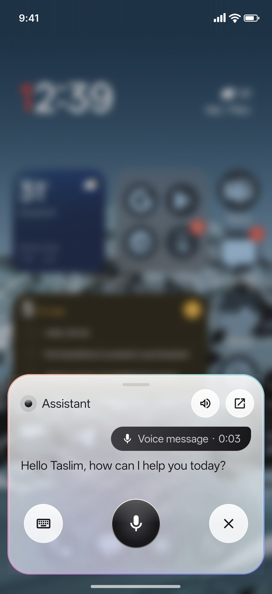
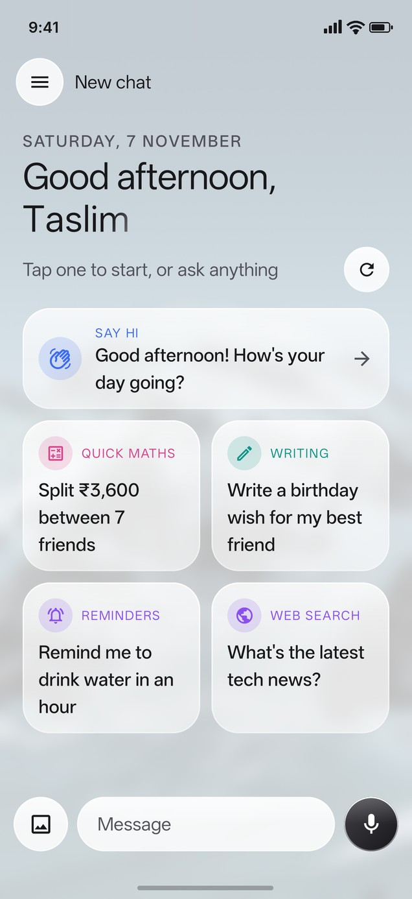
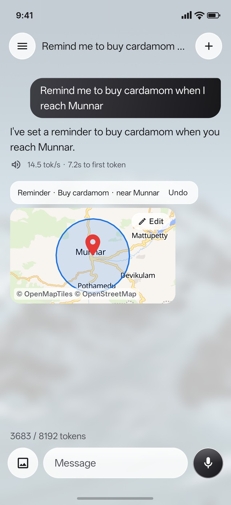
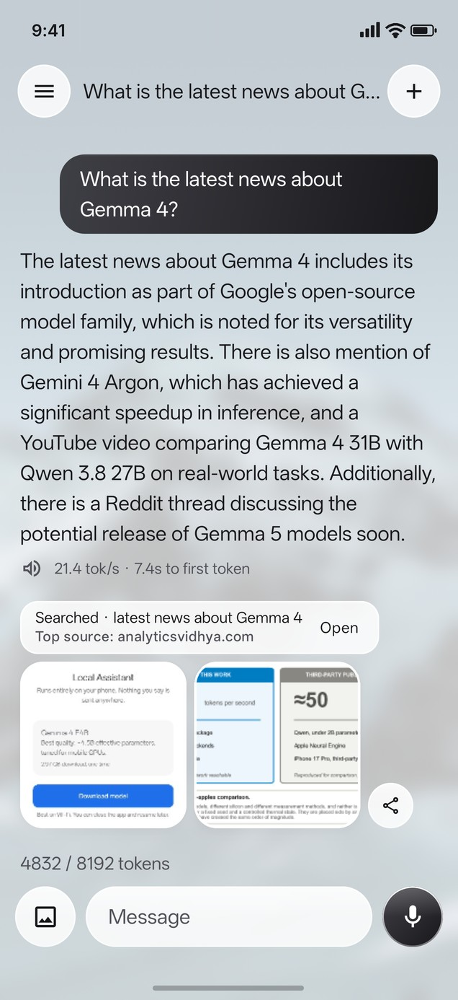
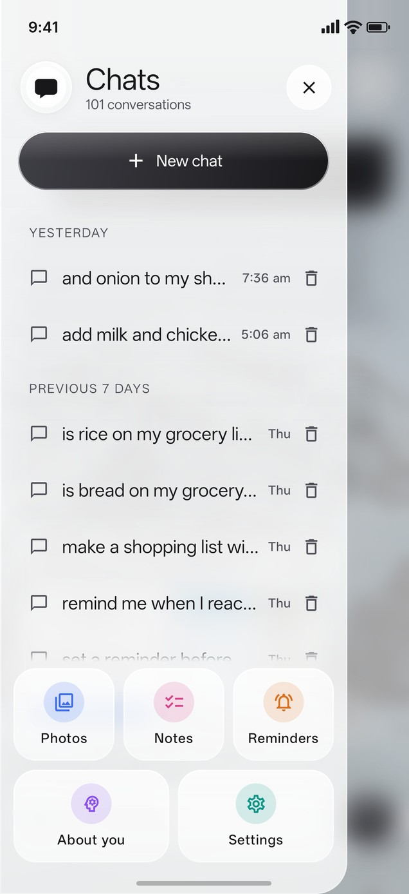

<div align="center">

# Local Assistant

**A private AI assistant that lives on your Android phone.**

It runs Google's Gemma 4 entirely on the device. It chats, listens, remembers you, sets reminders
and alarms, and answers when you hold the power button. No account, no server: nothing leaves the
phone for it to think.

<a href="https://github.com/taslimmuhammed/local_assistant_v2/raw/main/apk/LocalAssistant.apk"></a>

Android 8 or newer · 64-bit phone · 8 GB of RAM or more · about 4.5 GB free

&nbsp;
&nbsp;
&nbsp;
&nbsp;


[Watch the one-minute tour](promo/LocalAssistant_Promo_720p.mp4)

</div>

## What it can do

- **Answers from the power button.** Hold it over any app, like Gemini, or say "Hey Luna": it
  listens, sends when you pause, and answers out loud in a voice you pick. It can see the screen
  you called it over: "summarise this", "share this with Anjali".
- **Remembers you.** Your profile, facts you mention ("my dentist is Dr. Rao"), images you ask it
  to keep, and what you talked about in earlier chats. **About you** shows what it knows, to edit
  or delete.
- **Reminds you.** Reminders and events, repeating ones too ("every Monday"), and reminders for a
  place: "buy milk when I'm near DMart" rings when you get there. Alarms and timers too.
- **Keeps notes and lists.** "Add bread to my shopping list", "is bread on my list?"
- **Calls and messages.** It opens the dialer, SMS, WhatsApp or email ready to send, and finds the
  right contact even when a name is misheard. You tap send.
- **Runs your phone.** Opens apps, turns on the flashlight, sets silent or vibrate, the volume and
  Do Not Disturb, takes screenshots, and works out sums and unit conversions. Ask for several at
  once: "call Mom and set an alarm for 7".
- **Finds your photos and videos** by what's in them, who's in them, where and when: "beach
  videos", "photos of Anjali in Munnar last December". It names faces from your contacts' photos.
- **Reads your health data** from Health Connect: steps, distance, calories, heart rate, sleep and
  workouts.
- **Tells you what you missed** (off by default). When you come back to your phone, a card shows
  who called and who's waiting on a reply, with replies ready to send.
- **Looks things up** on the web, once you add a free [Tavily](https://tavily.com) key.
- **Sees and hears.** Send it a photo or a voice message.
- **Stays private.** It thinks on the phone, and keeps card numbers, ID numbers and photos of your
  documents hidden until you confirm it's you with your fingerprint, face or PIN.

## Install

1. **Download.** Open this page on your Android phone and tap **Download APK** above (26 MB). On a
   computer, download it and copy it to the phone.
2. **Install.** Open the file, and let your browser or file manager install apps when Android asks.
   The app isn't on Google Play and is signed with a development key, so Play Protect may warn
   you: choose to install anyway.
3. **Get the model.** Open Local Assistant. It asks a few optional things about you and for an
   optional web-search key, then for the model:
   - **Download** fetches Gemma 4 E4B (3.66 GB) from Hugging Face. Use Wi-Fi; it picks up where
     it stopped if interrupted.
   - **Load from device storage** uses a `.litertlm` model file you already have.

   Right after it, the app also downloads EmbeddingGemma 2 (0.39 GB) by itself, so it can find
   past conversations by meaning; the same model searches your photos. Nothing to do; no account
   needed.

It then takes about 15 seconds to get ready (it loads the model and reads its instructions), and
from then on answers right away.

### Use it from the power button

In the app, go to **Settings → Calling the assistant → Power button** and choose Local Assistant as the
*digital assistant app*. If holding the power button still brings up the power menu, switch it to
the voice assistant in your phone's power-button settings. You can also long-press the app icon
and pick **Talk**.

In the same place:

- While Local Assistant is the phone's digital assistant, the model stays loaded between questions
  (about 1.8 GB of memory), so the power button gets an answer in about a second. Some phones
  close it in the background anyway; if yours does it often, the chat says so once, with a link
  to the app's battery settings.
- **Use on the lock screen** (off by default) lets it answer without unlocking, with the power
  button or "Hey Luna", but only partly. On the lock screen it sees none of your memory, photos
  or chats. It can set reminders, events, alarms and timers, change phone settings, work out sums
  and look things up. For anything else, like remembering something or messaging someone, it asks
  you to unlock first and then carries on.
- **Voice** and **Answer out loud** set how it speaks. At the top of Voice is a natural voice that
  sounds like a person: a 334 MB download that uses about 600 MB of memory while it talks.
  Without it, the assistant uses your phone's own voices.
- **Wake word** (off by default): say "Hey Luna" to open the assistant, from anywhere, this app
  included, either only while charging or always. **Try it** checks that it hears you. Two small
  models in the app listen on the phone, one of them trained for this phrase, and the assistant
  opens when either hears it. Nothing they hear is kept or sent. It needs the app to be your
  digital assistant app, and it doesn't listen while the phone is locked unless **Use on the lock
  screen** is on.

### Optional extras

- **Memory search** is set up with the model. If the download didn't finish, get it from
  Settings → Model and memory search. Without it, past chats are still found by keywords.
- **Web search**: Settings → Web search, and paste a free key from [tavily.com](https://tavily.com).
- **Photos**: tap **Photos** in the chat drawer and turn on photo search. It uses memory search's
  model, so there is nothing more to download once that is here.
  There, **Find people in your photos** groups faces and names them from your contacts' photos.
- **Health data**: Settings → Health data → **Manage access**, to let it read Health Connect.
- **While you were away**: Settings → While you were away, then allow notification access. The
  notifications are read on the phone and kept for two days.

### Models and licences

- **Local Assistant** itself: [GNU General Public License v3](LICENSE). The natural voice's
  pronunciation comes from eSpeak NG (GPL v3), linked into the app through sherpa-onnx, so the
  whole app is under the same licence.
- **Gemma 4 E4B**, the assistant: by Google, from Hugging Face, Apache License 2.0.
- **EmbeddingGemma 2 (text and vision, 440M)**, memory search and photo search: by Google,
  downloaded from litert-community on Hugging Face, Apache License 2.0.
- **YuNet** (MIT) and **SFace** (Apache License 2.0), finding and telling faces apart for People:
  from OpenCV Zoo, converted to TensorFlow Lite; SFace's weights stored as 8-bit. See
  `app/src/main/assets/faces/NOTICE.txt`.
- **Place names** for searching photos by where they were taken: from
  [GeoNames](https://www.geonames.org), [CC BY 4.0](https://creativecommons.org/licenses/by/4.0/),
  reduced by `tools/places`. See `app/src/main/assets/places/NOTICE.txt`.

## Privacy

- The model runs on your phone. Your chats, what it remembers, your photos, your health data and
  your voice stay on the phone.
- The internet is used to download the models, and for these only when you use them:
  - **Web search**, once you add a key: your search goes to Tavily.
  - **Place reminders**: the place's name ("DMart") and a rough area about 30 km across go to
    OpenStreetMap's [Nominatim](https://nominatim.openstreetmap.org) search, to find it. Never the
    reminder, nor exactly where you are.
  - **Maps** for place reminders load from [OpenFreeMap](https://openfreemap.org).
  - **Report this reply** (the flag under a reply): that reply, the question before it and the
    reason you pick go to the developer through a Google Form. Nothing that says who you are.
- Card numbers, ID numbers and photos of your documents stay hidden until you confirm it's you
  with your fingerprint, face or PIN.
- No account, no ads, no analytics.

## Troubleshooting

| Problem | What to do |
|---|---|
| "App not installed" | It needs a 64-bit phone with Android 8 or newer, and room for the app. |
| Play Protect warns about it | Expected for apps from outside Google Play. Choose to install anyway. |
| "Getting ready…" for a while | The model is loading: about 10 s on a recent phone, longer on older ones. |
| The model download stopped | Open the app again; it carries on from where it stopped. |
| The app closes or is slow on a phone with less memory | Settings → Context window → 4K. |

## For developers

The app is Kotlin and Jetpack Compose on top of [LiteRT-LM](https://ai.google.dev/edge/litert-lm/android).
To build it you need JDK 17, the Android SDK, NDK 28.2.13676358 and CMake 3.22.1 (for
sqlite-vec):

```bash
./gradlew :app:assembleDebug
```

[docs/TECHNICAL.md](docs/TECHNICAL.md) explains how it all fits together: the memory system,
tools, the power-button assistant, and the measurements behind each choice.

**The download above** is `apk/LocalAssistant.apk`, version 0.2.0, SHA-256
`37dd1c4ddf9fd9208477bd8418d7a3b056add18f41e0770bd70dbfdcd960f354`. Rebuild it with:

```bash
./gradlew :app:demoApk -Pdemo
```

That builds for 64-bit phones only, compresses the native code, and signs with the local debug
key (see `app/build.gradle.kts`). Update the version and SHA-256 here when you replace it. Keep
it the only APK in git, since every copy stays in the repository's history.
